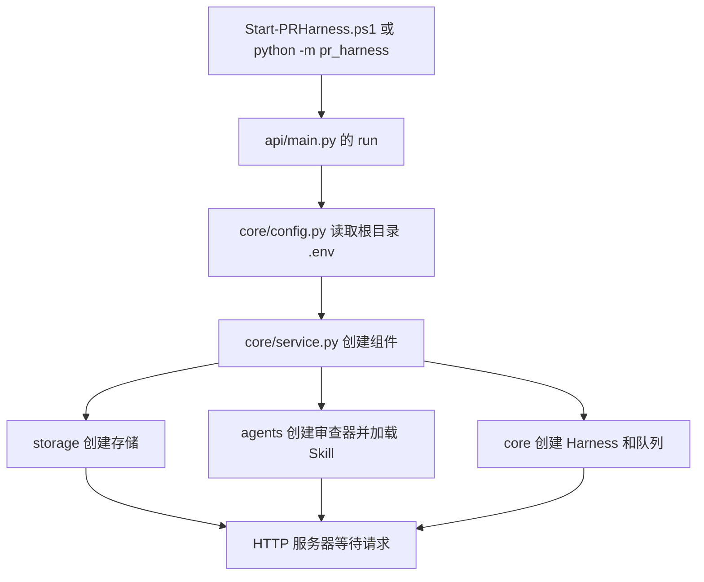
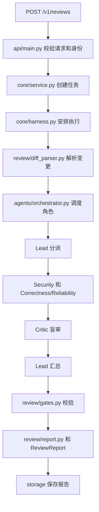

# 目录与流程

后端按职责分为 11 个领域目录，统一入口为 `python -m pr_harness`。

## 当前目录

```text
PR Harness/
├─ .env                    本机私有配置
├─ .env.example            配置模板
├─ .venv/                  本机 Python 环境
├─ Start-PRHarness.ps1       启动与配置检查
├─ README.md               从这里开始
├─ pr_harness/
│  ├─ __main__.py          Python 模块入口
│  ├─ api/                 HTTP 和认证
│  ├─ agents/              角色协作与 Skill 加载
│  ├─ core/                服务装配与执行运行时
│  ├─ review/              diff 规则 门禁 报告
│  ├─ memory/              记忆
│  ├─ storage/             存储
│  ├─ tooling/             仓库工具和 GitHub
│  ├─ repair/              修复与验证
│  ├─ evaluation/          评测
│  ├─ evolution/           版本进化与发布
│  └─ monitor/             监控
├─ web/                    静态管理页面
├─ skills/                 领域提示词包
├─ scripts/                实验和导入命令
├─ tests/                  现有测试
├─ docs/                   说明文档
├─ evaluation_data/        可选语料接入说明
└─ validation/             本机启动器状态与日志（不进入 Git）
```

## 启动流程



`core/paths.py` 集中保存 PACKAGE_ROOT 和 PROJECT_ROOT。HTTP 页面、配置加载和评测数据路径都从固定项目根定位，避免因为模块下移一层而读错目录。

## 审查任务流程



工具取证位于 tooling；任务恢复机制位于 core/runtime.py 和 core/harness.py；历史反馈位于 memory；自动修复位于 repair；回放比较位于 evaluation；候选激活与灰度位于 evolution。

## 旧教程如何对照

旧教程中的函数和类仍可按名称查找，但源码文件路径和 Python 模块导入已改变。例如原来的 `from pr_harness.store import TaskStore` 改成 `from pr_harness.storage.sqlite_store import TaskStore`。项目之外的旧练习脚本没有在本次整理中修改，运行前需要按下表调整导入及项目根目录。

| 原位置 | 当前位置 |
| --- | --- |
| `pr_harness/agentic_core.py` | `pr_harness/agents/orchestrator.py` |
| `pr_harness/api.py` | `pr_harness/api/main.py` |
| `pr_harness/auth.py` | `pr_harness/api/auth.py` |
| `pr_harness/config.py` | `pr_harness/core/config.py` |
| `pr_harness/context_manager.py` | `pr_harness/core/context_manager.py` |
| `pr_harness/diff_parser.py` | `pr_harness/review/diff_parser.py` |
| `pr_harness/evaluation_experiments.py` | `pr_harness/evaluation/experiments.py` |
| `pr_harness/evaluation_harness.py` | `pr_harness/evaluation/harness.py` |
| `pr_harness/evaluation_v2.py` | `pr_harness/evaluation/benchmark.py` |
| `pr_harness/evolution.py` | `pr_harness/evolution/prompt_evolution.py` |
| `pr_harness/evolution_proof.py` | `pr_harness/evaluation/evolution_proof.py` |
| `pr_harness/evolution_v2.py` | `pr_harness/evolution/candidate_generator.py` |
| `pr_harness/finding_identity.py` | `pr_harness/core/finding_identity.py` |
| `pr_harness/fixer.py` | `pr_harness/repair/rule_fixer.py` |
| `pr_harness/gates.py` | `pr_harness/review/gates.py` |
| `pr_harness/github.py` | `pr_harness/tooling/github.py` |
| `pr_harness/harness.py` | `pr_harness/core/harness.py` |
| `pr_harness/llm.py` | `pr_harness/core/llm.py` |
| `pr_harness/memory.py` | `pr_harness/memory/manager.py` |
| `pr_harness/metrics.py` | `pr_harness/monitor/metrics.py` |
| `pr_harness/models.py` | `pr_harness/core/models.py` |
| `pr_harness/modes.py` | `pr_harness/core/modes.py` |
| `pr_harness/observability.py` | `pr_harness/monitor/observability.py` |
| `pr_harness/patching.py` | `pr_harness/repair/patching.py` |
| `pr_harness/postgres_store.py` | `pr_harness/storage/postgres_store.py` |
| `pr_harness/report.py` | `pr_harness/review/report.py` |
| `pr_harness/repository_tools.py` | `pr_harness/tooling/repository_tools.py` |
| `pr_harness/review_rules.py` | `pr_harness/review/rules.py` |
| `pr_harness/reviewer.py` | `pr_harness/agents/reviewer.py` |
| `pr_harness/rollout.py` | `pr_harness/evolution/rollout.py` |
| `pr_harness/runtime.py` | `pr_harness/core/runtime.py` |
| `pr_harness/service.py` | `pr_harness/core/service.py` |
| `pr_harness/skill_evolution.py` | `pr_harness/evolution/skill_evolution.py` |
| `pr_harness/skills.py` | `pr_harness/agents/skills.py` |
| `pr_harness/store.py` | `pr_harness/storage/sqlite_store.py` |
| `pr_harness/task_queue.py` | `pr_harness/core/task_queue.py` |
| `pr_harness/telemetry.py` | `pr_harness/monitor/telemetry.py` |
| `pr_harness/verifier.py` | `pr_harness/repair/verifier.py` |
